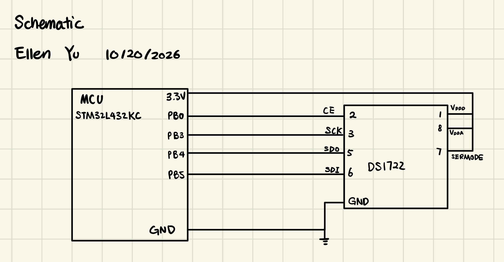
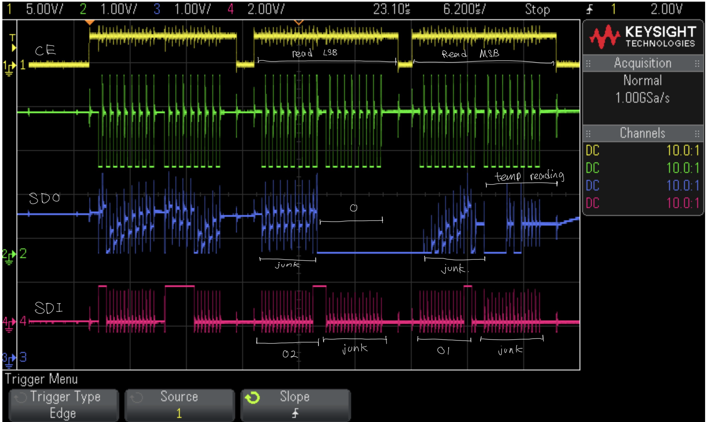

---
title: "Lab 6 - The Internet of Things and Serial Peripheral Interface"
description: "Using SPI to read temperature"
author: "Ellen Yu"
date: "10/20/26"
categories:
  - reflection
  - labreport
draft: false
--- 
## Introduction
The design for this lab takes in temperature measurement from a temperature sensor through SPI. 

## Design and Testing Methodology
The design communicates with the temperature sensor to get temperature readings and configure the temperature sensor resolution using SPI. The design is connected to a website through UART link to interface with the users. 

The baud rate is configured to 1250000. The system clock is at 80 MHz. As the baud rate is configured to be $f_{clk} / div factor$ to get down to the desired baud rate, the corresponding SPI register is modified to set the division factor to 64. The clock polarity (CPOL) and clock phase (CPHA) are both set to 1. 

For testing, since a logic analyzer is not avaliable in the lab, oscilloscope trace is used for testing and debugging.

## Technical Documentation

The source code for the project can be found in the associated [Github repository](https://github.com/Teemooooooooo/e155-lab6).

### Schematic

The schematic in @fig-schematic shows the physical layout of the MCU to sensor connection. The circuit design is based on the information found on the datasheet of the sensor.

::: {.callout-note collapse="true"}
## Schematic of the Design
{#fig-schematic}
::: 

### Oscilloscope trace

The annotated oscilloscope trace in @fig-scope_trace shows four signals: CE, SCK, SDO and SDI. It captures a full SPI write and read transaction.

::: {.callout-note collapse="true"}
## Oscilloscope trace
{#fig-scope_trace}
::: 

Based on the datasheet of DS1722, the maximum SCLK frequency it supports is 5 MHz. The baud rate is set to be 1.25 MHz, which is within the supported range of DS1722. 

## Conclusion

The design successfully display the temperature reading and adjust temperature reading resolution based on user input. However, this design does have a lag between user inpput and resolution adjustment. 

I spent 20 hours on this lab.

## AI Prototype summary

I used ChatGPT for this AI prototype. Chat ran for more than one minute and produced the whole HTML file. It also produced a temperature plot of all measurements taken. It even has dark mode. I think the output looks good.

For the second prompt, the code produced does correctly configure the necessary registers and the code does compile successfully. 