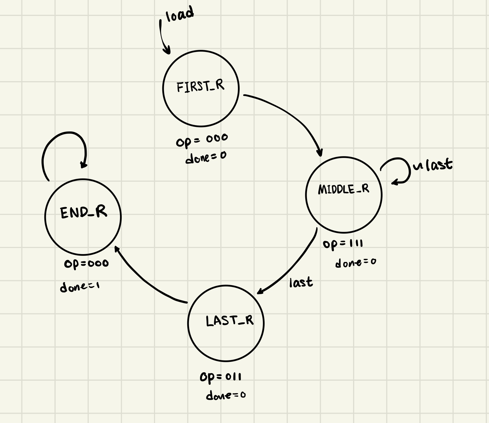
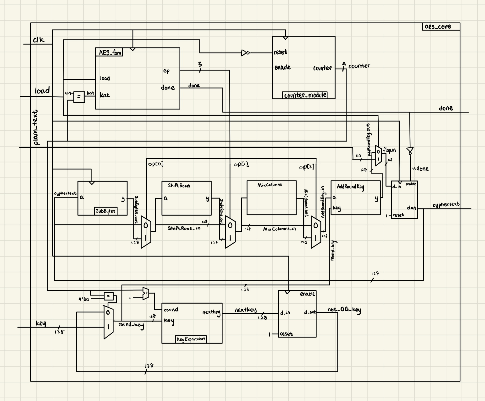
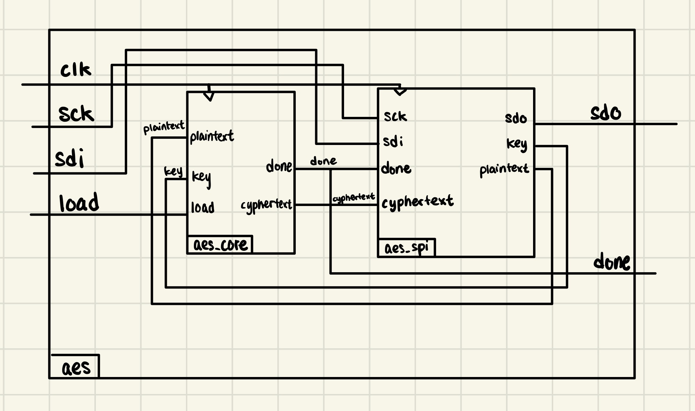
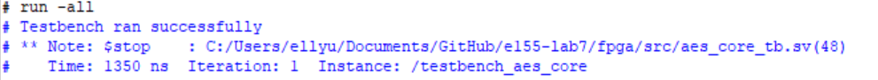
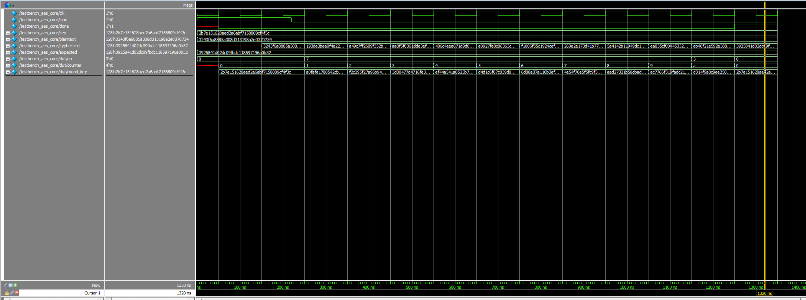
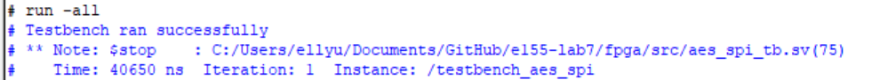
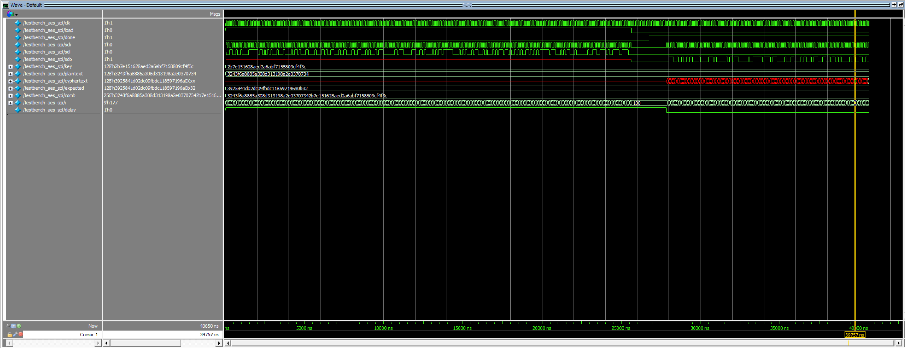

---
title: "Lab 7: The Advanced Encryption Standard"
description: "AES on FPGA"
author: "Ellen Yu"
date: "10/30/26"
categories:
  - reflection
  - labreport
draft: false
--- 

## Introduction
This design on FPGA performs 128-bit AES encryption. It receives a key and plaintext message from a micro-processor and produces 128-bit cyphertext.

## Design and Testing Methodology
The design on the FPGA uses SPI to communicate with the micro-processor. For the design to fit onto the FPGA, the logic elements of SubBytes, KeyExpansion, AddRoundKey, ShiftRows and MixColumns are reused for each round. A counter is used to keep track of which round of encryption the design is currently on and used to determine the key constant used and the operation performed on the cyphertext. 

The finite state machine that controls the operation performed in each round is shown in @fig-fsm.

::: {.callout-note collapse="true"}
## AES Finite State Machine
{#fig-fsm}
::: 


## Technical Documentation
The source code for the project can be found in the associated [Github repository](https://github.com/Teemooooooooo/e155-lab7).

### Block Diagram
The block diagram in @fig-aes_block shows the overall architecture of the AES FPGA design. 

::: {.callout-note collapse="true"}
## Overall AES Design Block Diagram
{#fig-aes_block}
::: 

The block diagram in @fig-top_block shows the architecture of the top level.

::: {.callout-note collapse="true"}
## Top Level Block Diagram
{#fig-top_block}
::: 

## Result and Discussion

### Testbench Simulation
The design does successfully pass both the ```aes_core_tb``` and ```aes_spi_tb``` testbenches.

@fig-test_win and @fig-waveform shown that the design passes ```aes_core_tb```.

::: {.callout-note collapse="true"}
## Design Passing aes_core_tb
{#fig-test_win}
:::

::: {.callout-note collapse="true"}
## Waveform of aes_core_tb
{#fig-waveform}
:::


@fig-test_spi and @fig-waveform_spi shown that the design passes ```aes_spi_tb```.

::: {.callout-note collapse="true"}
## Design Passing aes_spi_tb
{#fig-test_spi}
:::

::: {.callout-note collapse="true"}
## Waveform of aes_spi_tb
{#fig-waveform_spi}
:::

The DUT exhibits expected behavior for all test cases. 


## Conclusion

The design successfully produce 128-bit cyphertext from the given plaintext and key. 

I spent 21 hours on this lab.

## AI Prototype summary

I used ChatGPT to complete this AI Prototype. I noticed that the code produced by ChatGPT when given the first prompt is much easier to understand compared to the code generated by the second prompt. ChatGPT used ```gen_var``` syntax to generate the code, as it is prompted to generate something that has two while loops. Codes generated by ChatGPT for both prompts were able to synthesize. The next time I will try to give it more context of what I am trying to achieve in order to obtain more legible code.